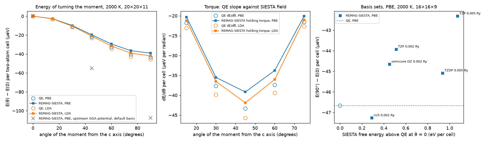

# Magnetic anisotropy of hcp cobalt with a constrained moment

Cobalt's magnetization prefers to lie along the c axis of its hexagonal crystal. Turning it away costs energy, of order 65 micro-electronvolts per atom in experiment. That cost, as a function of the angle θ between the magnetization and the c axis, is the magnetocrystalline anisotropy. To compute it one needs the energy of a state whose magnetization points at an angle the crystal does not prefer.

REMAG is a GPU-accelerated build of the SIESTA electronic-structure code; "REMAG-SIESTA" below means SIESTA 5.4.2 with REMAG's changes. Its constrained-moment option (see [the method](../../docs/SPIN_CONSTRAINT.md)) produces such a state. It treats a chosen group of atoms as one site and holds the site's spin moment along a target direction. Inside every self-consistent (SCF) calculation it adds an energy penalty that grows with the moment's sideways component, and between SCF calculations it adds a sideways field until the moment points at the target. When the calculation is consistent, that final field also gives the slope of the energy: dF/dθ = −(b·e_θ)|M|, where b is the field, e_θ the direction of increasing θ and |M| the moment. This slope is the torque needed to hold the moment, and every constrained run reports it. REMAG-SIESTA runs either on the GPU ("device") or on the CPU ("host"). Both use the same constraint code.

This benchmark compares REMAG-SIESTA with two references. The first is Quantum ESPRESSO (QE), run with the same functional, pseudopotential, smearing and k meshes. QE holds the moment with a penalty on each atom's polar angle, scaled by a strength λ. As λ grows the angle error vanishes and QE's energy approaches the constrained energy. The second reference is the measured anisotropy of cobalt.

## What the runs show

The comparison below uses two choices that the first comparison (described further down) did not. Spin-orbit coupling is applied with the pseudopotential's full projectors (`Spin spin-orbit+offsite`), as QE applies it. The gradient-corrected functional is evaluated for noncollinear spin as QE evaluates it (`REMAG.XC.NoncollinearGGA local-frame`, see [noncollinear GGA](../../docs/NONCOLLINEAR_GGA.md)). The REMAG-SIESTA basis is TZP with orbitals confined at 0.005 Ry and a 1200 Ry real-space grid. All runs smear occupations with Fermi-Dirac at 2000 K, where both codes are converged in k from 16×16×9 onward.



The left panel plots E(θ) − E(0) per two-atom cell at 20×20×11. With PBE, REMAG-SIESTA gives −9.9, −19.7, −29.4 and −39.1 micro-eV at 30, 45, 60 and 90 degrees, and QE −10.9, −21.8, −32.5 and −43.4. Fitting E = K₁ sin²θ + K₂ sin⁴θ to all seven angles gives K₁ = −39.5 micro-eV in REMAG-SIESTA and −43.6 in QE. With the local-density approximation (PW92, on the same PBE pseudopotential in both codes) K₁ is −42.5 against −46.3. In both codes the curve is a sin²θ to within K₂/K₁ of about 1%. The grey crosses are REMAG-SIESTA with upstream SIESTA's treatment of the gradient correction and SIESTA's default basis (0.02 Ry, 600 Ry grid), which gives −107.6 micro-eV at 90 degrees.

The middle panel compares torques. Each REMAG-SIESTA point is the holding torque of one run, with the moment held until its sideways component was below 1×10⁻⁶ Bohr magnetons. Each QE point is the slope of QE's fitted E(θ) at that angle. The two agree in shape, and REMAG-SIESTA's torques are 0.90 to 0.94 of QE's in PBE and 0.92 in LDA at every angle, the same ratio as K₁. REMAG-SIESTA's torques also match the slope of its own energies, to 0.3 to 4.6% here, where energies are printed to 1 micro-eV, and to 0.4% in a dedicated check at 6×6×3: the field-implied and finite-difference slopes at 45 degrees have a ratio of 1.0044, against 1.005 expected from the ±5 degree central difference itself.

The right panel traces the remaining difference to the basis. At 16×16×9, where QE gives −46.7 micro-eV, REMAG-SIESTA's anisotropy approaches QE's as its free energy approaches QE's from above:

- TZP with 0.005 Ry confinement, 1.07 eV per cell above QE: −42.3 micro-eV;
- TZDP at 0.005 Ry, 0.94 eV above: −45.1;
- TZP at 0.002 Ry, 0.51 eV above: −43.9;
- the 3s and 3p semicore shells doubled, 0.45 eV above: −44.7;
- a basis close to quadruple zeta with two 4p shells and a 4f shell, 0.29 eV above: −47.3.

QE's energy is converged to 1.4 meV per cell at its 100 Ry cutoff, and REMAG-SIESTA's to 2 meV between 600 and 1800 Ry of grid. The basis ladder is not monotonic, because longer orbitals and more functions help different parts of the band structure, but the most complete basis tried lands within 0.6 micro-eV of QE.

Without smearing the two codes have not converged. With the optimized tetrahedron method ([tetrahedron occupations](../../docs/TETRAHEDRA.md)), QE's PBE anisotropy at 16, 20, 24, 28 and 32 points along a is +94, +49, +64, +45 and +53 micro-eV, with the easy axis along c as in experiment. REMAG-SIESTA, with the 0.005 Ry basis, gives +68 at 20 and +78 at 24. In LDA QE gives +43, +46, +2 and +4 at 16 to 28, and REMAG-SIESTA +52 and +14 at 20 and 24, following QE's drop at the same mesh. A zero-temperature value would need meshes beyond 32×32×17 in both codes.

Experiment gives 131 micro-eV per cell with the easy axis along c (`reference/experiment.json`). The zero-temperature PBE values above have the right sign and are of the same order, but they are not converged, so no agreement can be claimed. Density functionals without orbital corrections are known to misjudge this quantity for cobalt: in the local spin-density approximation, Aas et al. obtained 6.7 micro-eV per atom with the easy axis in the plane.

## Why the first comparison disagreed

The first comparison, kept in `reference/siesta.json` and `reference/qe.json` and drawn in `anisotropy.png`, used SIESTA's defaults: spin-orbit coupling in the on-site approximation, and the gradient correction for noncollinear spin as libgridxc computes it. At 2000 K and 20×20×11 it found REMAG-SIESTA's E(90°) − E(0) between −46 and −136 micro-eV, depending on basis and grid, against QE's −43.

Off-site spin-orbit coupling was not the cause: it gives −107.7 micro-eV where on-site gave −108. The gradient correction was. The torque check above, run with libgridxc's own noncollinear GGA, gives a ratio of 2.38 instead of 1.005, while LDA gives 1.005. libgridxc's potential leaves out how the local spin direction depends on the density, so the SCF does not minimize the energy it reports. With the local-frame treatment the same check gives 1.004. At identical settings (16×16×9, the 0.005 Ry basis, 1200 Ry grid) the anisotropy drops from −92.1 to −42.3 micro-eV, and with the default basis at 20×20×11 from −107.6 to −68.1. The tests above use that treatment. [Noncollinear GGA](../../docs/NONCOLLINEAR_GGA.md) explains the three choices REMAG offers.

The constraint itself was never in question. At 0 and 90 degrees the moment lies along a symmetry direction and no constraint acts, so the disagreement at those angles came from the functional. In all 75 first-round runs and all 69 second-round runs at those tolerances, the first SCF calculation already met the requested 0.01 degree and 0.001 Bohr magneton; the largest angle error was 0.003 degrees. The 18 torque runs, held to 1×10⁻⁶ Bohr magnetons, took two to four SCF calculations.

## Acceptance checks

`compare.py --check` applies the first round's checks to `reference/siesta.json` and `reference/qe.json`. `compare_r2.py --check` applies these to the second round:

- With PBE and with LDA at 2000 K and 20×20×11, REMAG-SIESTA's K₁ is within 15% of QE's.
- In both functionals, every holding torque from 15 to 75 degrees is within 15% of QE's slope.
- At identical settings, libgridxc's own gradient correction gives at least 1.8 times the local-frame anisotropy, which records the failure the second round fixes.
- Every basis in the ladder lies above QE in energy.
- The local-frame PBE torque check at 6×6×3 gives a ratio within 0.5% of the finite-difference factor 1.005.

The thresholds were chosen after the runs were seen. They guard against regressions; they were not predictions. The zero-temperature tetrahedron values are reported, not checked, because neither code is converged.

## What is held the same

Both codes describe the same crystal: hcp cobalt with a = 2.507 Å and c = 4.069 Å, two atoms per cell at the ideal positions. Both use spin-orbit coupling with noncollinear spin and the PseudoDojo fully relativistic PBE standard pseudopotential for Co (nc-fr-04, 17 valence electrons). SIESTA reads it as `Co.psml` (sha256 0b5b2fd0…) and QE as `Co.upf` (sha256 3413bc80…). Both files come from the same PseudoDojo release. Their ten projector energies agree to six decimals, and their local potentials agree to 8×10⁻⁴ Ry out of 57 Ry. LDA runs use PW92 on this same pseudopotential in both codes (`XC.authors PW92`, `input_dft = 'pw'`), because PseudoDojo publishes no fully relativistic LDA set. Both codes use Fermi-Dirac smearing at the same temperature, or the optimized tetrahedron method, on the same Γ-centred k meshes.

Four things differ, and they limit the comparison. SIESTA expands the wavefunctions in localized atomic orbitals; QE uses plane waves up to 100 Ry. SIESTA constrains each site's Mulliken spin moment; QE constrains the moment inside a sphere around each atom. QE's penalty (`constrained_magnetization = 'atomic direction'`) acts only on the polar angle, leaving the moment free to turn about the c axis, which in hcp cobalt costs essentially nothing. Finally, QE uses the crystal's symmetry to reduce the k points, while SIESTA with spin-orbit coupling sums the full mesh. Both sums are over the same points.

In QE 7.3.1 the penalty field is scaled by the volume of one grid cell (`PW/src/add_bfield.f90`; the factor was removed after 7.3.1), so the λ values quoted are nominal. At 45 degrees QE's angle error falls as 1/λ and its energy changes by at most 0.14 micro-eV per cell from λ = 5 Ry upward, so the runs at λ = 25 Ry are in the large-λ limit whatever the scale.

Both atoms are constrained together as one site, so every run turns the whole magnetization to the same angle θ at azimuth φ = 0, toward the a axis.

## Running the REMAG side

The REMAG-SIESTA runs need a REMAG build (see [running instructions](../../docs/RUNNING.md)) and the PseudoDojo file. Fetch the pseudopotential:

```sh
curl -sSL -o standard.tgz https://www.pseudo-dojo.org/pseudos/nc-fr-04_pbe_standard_psml.tgz
mkdir standard && tar -xzf standard.tgz -C standard
sha256sum standard/nc-fr-04_pbe_standard/Co.psml   # 0b5b2fd03ad89e4afa8ec8d2ca2347b22e02e1a679a685cbf00adb83da99acbe
```

Write the inputs of the second round, run each directory on the host path, collect and compare:

```sh
python make_siesta.py run/pbe-k20 --psml standard/nc-fr-04_pbe_standard/Co.psml --kmesh 20,20,11 \
    --temperature 2000 --thetas 0,30,45,60,90 --soc offsite --nc-gga local-frame \
    --h-tolerance 1.e-5 --shift 0.005 --mesh 1200
for d in run/pbe-k20/theta*; do (cd $d && REMAG_GPU=0 siesta < input.fdf > output.out); done
python extract_siesta.py run --output siesta-new.json
```

`--xc PW92` gives LDA, `--occupation Tetrahedra.Optimized` the tetrahedron method, `--pao-block semicore-dz` or `rich` the larger bases. The torque runs tighten `REMAG.SpinConstraint.TorqueTolerance` to `1.e-6` in the written `input.fdf`. Local-frame runs use a change-in-H tolerance of 1×10⁻⁵ eV because that treatment leaves it flickering near 5×10⁻⁶ eV (see [noncollinear GGA](../../docs/NONCOLLINEAR_GGA.md)). The GPU path accepts neither tetrahedra nor the local-frame GGA, and at most 128 k points, so these runs use the host path. A 20×20×11 run takes 15 to 40 minutes on one CPU core.

## Running the QE side

The QE results are retained in `reference/qe.json` and `reference/qe-r2.json`, so the tests do not need QE. To reproduce them, use the NVIDIA HPC container `nvcr.io/hpc/quantum_espresso:qe-7.3.1` on one GPU. Put the PseudoDojo `Co.upf` (nc-fr-04_pbe_standard, sha256 3413bc80…) in a directory, then:

```sh
python make_qe.py qe/k20 --pseudo-dir /path/to/pseudo --kmesh 20,20,11 --temperature 2000 \
    --thetas 0,15,30,45,60,75,90 --lambdas 25
for d in qe/k20/lambda25/theta*; do (cd $d && mpirun -np 8 pw.x -nk 8 -in pw.in > pw.out); done
python extract_qe.py qe --output qe-new.json
```

`--dft pw` gives LDA and `--occupation tetrahedra_opt` the tetrahedron method; tetrahedron runs stop at 1×10⁻⁸ Ry because pw.x's SCF stalls near 1×10⁻⁹ Ry with them. Eight k-point pools sharing one GPU are fast only under CUDA MPS (`nvidia-cuda-mps-control -d` first).

## Files

`make_siesta.py` and `make_qe.py` write the inputs. `extract_siesta.py` and `extract_qe.py` turn finished runs into the JSON records under `reference/`. `compare.py` draws `anisotropy.png` and applies the first round's checks; `compare_r2.py` draws `anisotropy-r2.png` and applies the second round's. `reference/siesta.json` and `reference/qe.json` hold the first round, `reference/siesta-r2.json` and `reference/qe-r2.json` the second, one record per run with the hash of each input. `reference/siesta-checks.json` holds the first round's device-versus-host and torque checks. `reference/experiment.json` holds the measured value and its source. The tests in `tests/test_spin_constraint_hcp_co.py` read these records.
